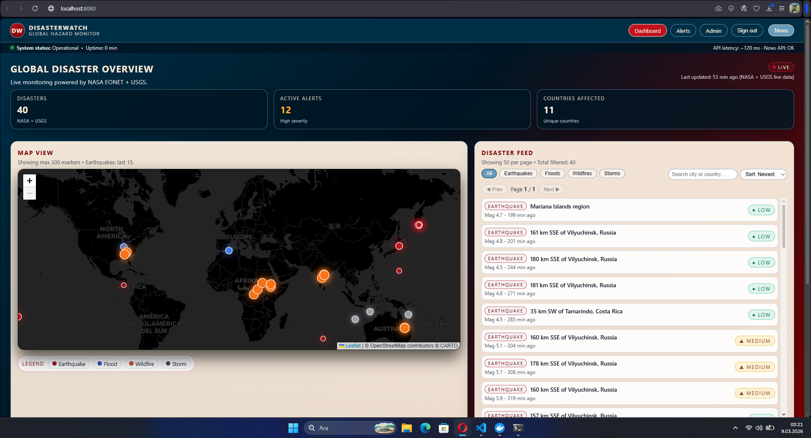

# DisasterWatch

[](https://github.com/OrhanIzmirli/DisasterWatch/actions/workflows/ci.yml)

A real-time disaster monitoring platform that merges NASA EONET and USGS into one live map, rates every event from what the sources publish, and sends location-based alerts through a Kafka pipeline.

**Live:** https://disasterwatch-frontend.onrender.com (free hosting: the first request after a quiet spell can take up to a minute while the services wake up, see [Limits](#limits)).

> DisasterWatch is a portfolio project, not an official warning service. For warnings and evacuation orders follow your local authorities.



More in [Screenshots](docs/screenshots.md).

---

## Features

- **One feed from two sources:** USGS earthquakes (M 4.5+) and NASA EONET wildfires, floods and storms, normalized into one model; one failing source degrades the feed instead of breaking it.
- **Live dashboard:** Leaflet map with clustered, severity-coloured markers, an event drawer, filters, search, sorting and KPIs. No demo or fallback data anywhere.
- **Severity from the source:** GDACS impact level, magnitude, Saffir-Simpson on the peak wind or burned area; an event the source gives no intensity for is shown as *not rated*, never guessed ([Severity](docs/severity.md)).
- **News linked to events:** GDELT, The Guardian and GDACS media, filtered by relevance rules and placed in a country and region ([News](docs/news.md)).
- **Location-based alerts:** subscriptions by hazard type, minimum severity and radius; in-app notifications and opt-in e-mail with double opt-in and one-click unsubscribe.
- **Event-driven pipeline:** transactional outbox, Kafka topic `disaster-events`, idempotent consumer: at-least-once delivery, at most one notification per user and event ([Architecture](docs/architecture.md#event-driven-notification-pipeline)).
- **Accounts, privacy and admin:** cookie sessions, self-service account deletion, a privacy page, and an admin console with an audit log.
- **Runs anywhere:** one `docker compose up` locally; the same images run on free cloud tiers (Render, Neon, Aiven, Resend).

---

## Architecture

```
                      ┌──────────── backend (Express + Prisma) ────────────┐
NASA EONET ──┐        │ feed cache (5 min) ──────────────> GET /disasters  │
USGS ────────┼──────> │ GDACS impact level + point (severity, location)    │
GDACS ───────┘        │ ingestion job ─> IngestedEvent (outbox) ─┐         │
GDELT, Guardian,      │ news job ─> NewsCache ─────────> GET /news│        │
GDACS media ────────> │ accounts, alerts, admin, privacy          │        │
                      └───────────────────────────────────────────┼────────┘
                                                                  │ publish
                                                       Kafka topic disaster-events
                                                                  │ consume
                      ┌──────────── notification-service ─────────▼────────┐
                      │ match subscriptions ─> Notification (in-app bell)  │
                      │ e-mail dispatcher ─> EmailDelivery ─> Resend       │
                      └────────────────────────────────────────────────────┘
React (Vite) frontend ── /api ──> backend          PostgreSQL: one database for both services
```

The public map and feed need only the backend and the sources; Kafka, the notification service and Resend carry the alerts. Each part degrades on its own and reports its state in `/health`. Details: [Architecture](docs/architecture.md).

---

## Tech stack

- **Frontend:** React 19, TypeScript, Vite 7, Leaflet / react-leaflet, React Router
- **Backend:** Node.js 24, Express 5, Prisma 6, Zod, helmet, express-rate-limit, KafkaJS
- **Notification service:** Node.js 24, KafkaJS, `pg`, Zod
- **Infra:** Docker, Docker Compose, Nginx, PostgreSQL 16, Confluent Kafka 7.6.1
- **Cloud (optional):** Render, Neon, Aiven, Resend
- **Tests / CI:** Vitest, supertest, Testing Library, ESLint, GitHub Actions

---

## Quick start (Docker Compose)

### Prerequisites

| Tool | Version | Notes |
|---|---|---|
| Docker with Compose v2 | Docker Desktop 4.x or Docker Engine 24+ (`docker compose version` works) | the only hard requirement |
| Git | any | |
| Node.js | `24.13.0` (`.nvmrc`) | only for running services or tests outside Docker |

Ports used on the host: **8080** (frontend), **5000** (backend), **5432** (PostgreSQL), **9092 / 29092** (Kafka), **2181** (Zookeeper). Stop anything else listening there first.

### 1) Clone and create the backend env file

```bash
git clone https://github.com/OrhanIzmirli/DisasterWatch.git
cd DisasterWatch
cp backend/.env.example backend/.env
```

`backend/.env.example` ships with a **dev-only `JWT_SECRET` placeholder** that the server accepts only with `NODE_ENV=development` (which Compose sets for the local stack); in production it is rejected, so generate a real one before any deployment (see [Environment variables](docs/operations.md#environment-variables)). To get an admin account, put your e-mail in `ADMIN_EMAILS` in `backend/.env` before registering.

### 2) Build and start

```bash
docker compose up --build
```

First start takes a few minutes (image pulls + `npm ci`). What happens:

1. `db` starts and passes its health check; `zookeeper` and `dw-kafka` start, the broker passes its health check.
2. `backend` runs `prisma db push` against the database (creates the tables on a fresh volume, no-op afterwards) and then starts the API. It logs `Backend listening on port 5000`, then `Kafka producer initialized`, then the first ingestion run.
3. `notification` connects to the database and to Kafka and logs `Notification service listening on topic: disaster-events`.
4. `frontend` serves the built app on port 8080 and proxies `/api/*` to the backend.

### 3) Open it

| URL | What you get |
|---|---|
| http://localhost:8080 | the app |
| http://localhost:8080/api/health | backend health through the Nginx proxy |
| http://localhost:8080/api/disasters | the normalized feed |
| http://localhost:5000/health | backend directly |

Register at http://localhost:8080/signup (any e-mail, password 8+ characters). Set up an alert on the Alerts page; the bell fills up when a new matching event arrives (events older than 48 hours never notify).

### Stop, reset

```bash
docker compose down          # stop, keep the database volume
docker compose down -v       # stop and delete the database volume (fresh start next time)
```

---

## Tests

| Suite | Command | Needs |
|---|---|---|
| Backend (Vitest + supertest) | `cd backend && npm test` | `TEST_DATABASE_URL`, a throwaway PostgreSQL |
| Notification service (Vitest) | `cd notification-service && npm test` | nothing for the unit tests; the e-mail dispatcher tests run only with `TEST_DATABASE_URL` (schema pushed from `backend/prisma`) and are skipped otherwise |
| Frontend (Vitest + Testing Library, ESLint) | `cd disasterwatch-frontend && npm run lint && npm test && npm run build` | nothing (lint, tests, type check + production build) |

The backend suite refuses to run against the application database. **CI** (`.github/workflows/ci.yml`) runs all three suites on every push and pull request. Details, including a throwaway test database: [Tests and CI in detail](docs/operations.md#tests-and-ci-in-detail).

---

## Limits

- **Alerts can be hours late.** The free services sleep after about 15 minutes; a scheduled GitHub workflow wakes them every few hours, and events older than 48 hours never notify.
- **Free infrastructure.** Cold starts take up to a minute, GDACS is often slow, Aiven's free Kafka powers off when idle, and the free plans cap database size, instance hours and e-mails.
- **An alert carries the level known when the event was first seen.** A later rise of an event's GDACS level sends no new alert.
- **Source coverage.** Only what USGS (M 4.5+) and NASA EONET report: no volcanoes, landslides, tsunami warnings or official warnings; floods are rated only through GDACS.
- **News and e-mail.** GDELT rate-limits most requests, so the news panel can be thin; without its own sending domain, e-mail reaches only the Resend account owner.

The full list with measurements: [Limits](docs/operations.md#limits).

---

## Documentation

| Document | Contents |
|---|---|
| [Architecture](docs/architecture.md) | services, methodology, features in detail, notification pipeline, event contract, Kafka demo, repository layout |
| [HTTP API](docs/api.md) | endpoints and the `GET /disasters` feed contract |
| [Severity](docs/severity.md) | how events are rated and how the thresholds were derived |
| [News](docs/news.md) | providers, relevance rules, event linking, regions, Guardian licence |
| [Operations](docs/operations.md) | limits, running outside Docker, tests, environment variables, cloud deployment, scheduled wake-up, e-mail alerts, deploy order |
| [Screenshots](docs/screenshots.md) | the app and the local stack |
| [Changelog](CHANGELOG.md) | notable changes |
| [Contributing](CONTRIBUTING.md) | branch, review and no-risk-zone rules |
| [Frontend](disasterwatch-frontend/README.md) | the React app on its own |

---

## Author

Orhan Izmirli — Computer Science student (Poland). Project focus: full-stack development, event-driven architecture, distributed systems and cloud-ready deployments.
