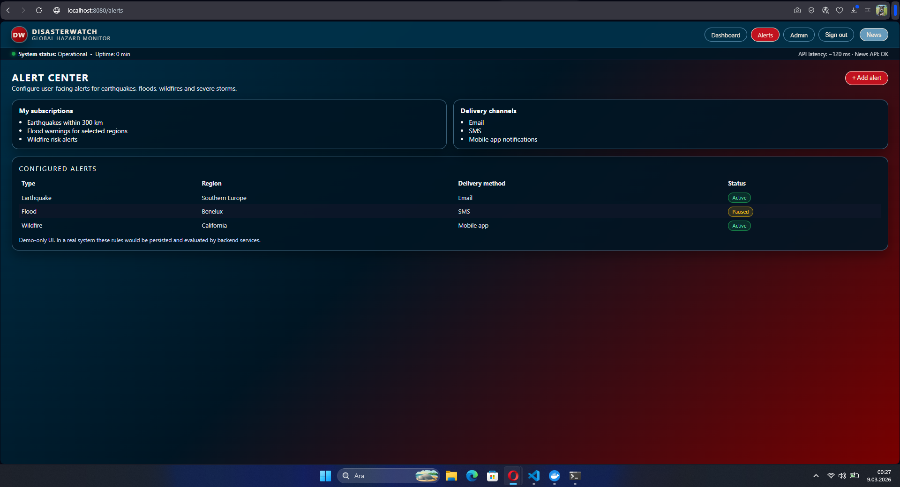
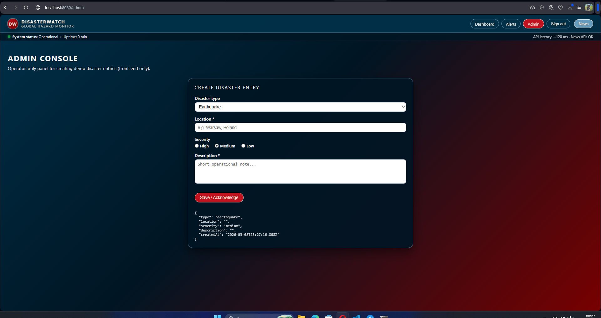
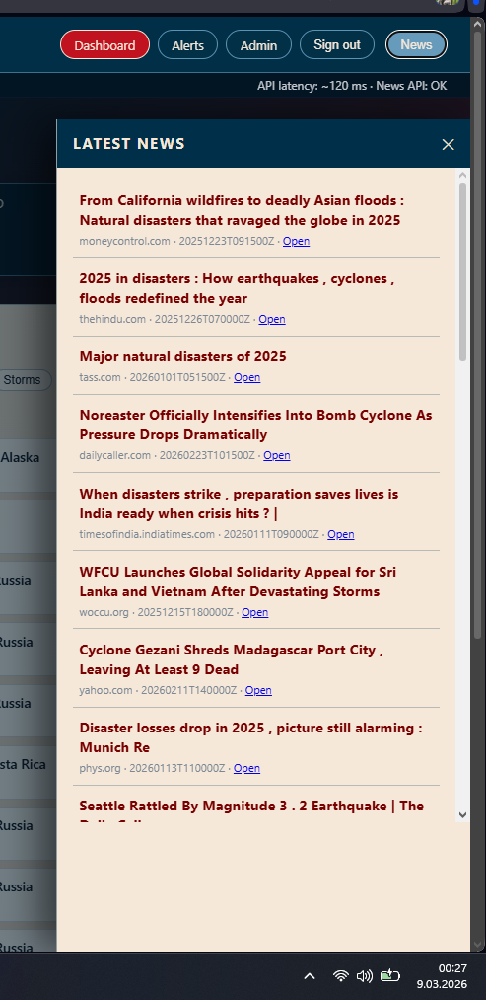

# DisasterWatch

[](https://github.com/OrhanIzmirli/DisasterWatch/actions/workflows/ci.yml)

A cloud-ready, real-time disaster monitoring platform that aggregates global disaster signals using **NASA EONET + USGS**, normalizes multi-source API responses into a single schema, visualizes events on an interactive map, and uses **Kafka** for event-driven processing via producer/consumer microservices.

Note: The project is designed to be **fully runnable on localhost** via Docker Compose (cloud deployment is optional). This makes it easy to demo in interviews without requiring cloud credentials.

---

## Features

### 1) Multi-Source Disaster Data (NASA EONET + USGS)
- Fetches global disaster data from:
  - **USGS** (Earthquakes)
  - **NASA EONET** (Wildfires, floods, storms, etc.)
- Normalizes heterogeneous API responses into a single unified model
- Performance-safe rendering (pagination + marker caps)

### 2) Live Dashboard (Map + Feed + KPI)
- Interactive **world map** with disaster markers
- Live disaster feed with pagination
- KPI overview:
  - Total disasters
  - Active alerts (high severity)
  - Countries affected

### 3) Filtering, Search, Sorting
- Filter by disaster type:
  - Earthquakes
  - Wildfires
  - Floods
  - Storms
- Search by country/city keyword
- Sorting options:
  - Newest
  - Severity

### 4) Severity Scoring (LOW / MEDIUM / HIGH)
- Each event is classified into severity levels
- Severity badges shown directly in the feed
- Helps prioritize critical events

### 5) Event-Driven Architecture (Kafka)
DisasterWatch streams disaster events through Kafka to decouple ingestion from processing.

**Producer (Backend)**
- After processing/normalizing disaster data, backend publishes structured messages to Kafka topic:
  - `disaster-events`

Example message:
```json
{
  "type": "earthquake",
  "location": "Turkey",
  "severity": "high",
  "timestamp": "2026-03-08T22:25:00Z"
}
```

**Consumer (Notification Service)**
- Subscribes to `disaster-events`
- Logs received events (ready for future alert pipelines: Email/SMS/WebSocket push)

### 6) Dockerized Microservices (Local + Cloud-Ready)
- Fully containerized services:
  - frontend (React build served by Nginx)
  - backend (Node.js + Express)
  - db (PostgreSQL)
  - kafka (Confluent Kafka) + zookeeper
  - notification-service (Kafka consumer)
- Runs locally with a single Docker Compose command

### 7) Bonus UI Modules (Demo-Ready)
- Alerts page UI (demo)
- Admin console UI (demo)
- News modal UI (demo)

---

## App Screenshots

### 1) Main Dashboard (KPI + Map + Live Feed)
Shows the complete overview: KPIs at the top, map markers, and live feed on the right.  


---

### 2) Backend Health (API Proof)
Confirms backend is running and reachable through the reverse proxy `/api`.  


---

### 3) Disasters API Response (Normalized Output)
Shows normalized disasters data returned by the backend.  


---

### 4) Disasters API Response (Alt View)
Alternative capture (useful to show larger payload / different portion).  


---

### 5) Docker Compose (All Services Up)
Proves that frontend, backend, database, Kafka, zookeeper, and notification service are all running together.  


---

### 6) Kafka Consumer Receives Event (End-to-End Proof)
Shows the notification-service consuming a message from Kafka topic.  


---

### 7) Kafka Topics (Topic Exists)
Confirms the `disaster-events` topic exists.  


---

### 8) Filter Example — Earthquakes
Clicking Earthquakes updates the feed and map context.  


---

### 9) Filter Example — Wildfires
Switching to Wildfires updates markers and feed.  


---

### 10) Search Example (Country/City)
Search input filters events by keyword (country/city).  


---

### 11) Sort Example — Newest
Sort dropdown configured for Newest (time-based monitoring).  


---

### 12) Sort Example — Severity
Sort dropdown configured for Severity (critical-first view).  


---

### 13) Severity Badges (LOW / MEDIUM / HIGH)
Shows severity classification badges inside the feed.  


---

### 14) Map Marker Popup / Detail
Clicking a marker reveals detail popup.  


---

### 15) Alerts Page (Demo UI)
Demo UI for alert rules & channels (future persistence ready).  


---

### 16) Admin Console (Demo UI)
Demo operator panel for creating demo disaster entries.  


---

### 17) News Modal (Demo UI)
In-app modal showing disaster-related news.  


---

## News

`GET /news` is served from a cache that a background job refreshes every 15 minutes (`src/services/news.service.js`). Each refresh picks the ~10 most important feed events (high severity first, then newest), cleans their location text (`"Flood in Nepal 1104225"` -> `Nepal`, `"53 km S of Kushiro, Japan"` -> `Kushiro Japan`, in `src/services/newsLinking.js`) and runs one targeted, English-only, last-72-hours GDELT search per event plus one general disaster search. Articles are deduplicated by URL and near-identical title and linked to their event, which powers the "Show on map" button in the news panel and the "Related news" section of the event drawer.

GDELT allows one request every 5 seconds and answers violations with HTTP 429 and a plain-text body; the client (`src/services/gdelt.js`) throttles requests, times them out (`GDELT_TIMEOUT_MS`) and treats 429 / non-JSON as failures. A failed refresh keeps the previous articles and marks the response `stale: true`; with no cache at all the endpoint answers 503 and the panel shows a retry button. Response shape: `{ items: [{ title, url, domain, publishedAt, image, relatedEvent }], count, updatedAt, stale }`, filterable with `?type=` and `?event=`.
=======
## Event-Driven Notification Pipeline

```
NASA EONET ──┐                                   ┌─> AlertSubscription rules
             ├─> backend ingestion job (5 min) ──┤   (type, min severity, radius)
USGS ────────┘   IngestedEvent (ON CONFLICT      │
                 DO NOTHING) -> only NEW events  ▼
                 ──publish──> Kafka topic ──> notification-service ──> Notification table
                              disaster-events    (consumer, pg)          │
Admin POST /events ──validate contract──┘                                ▼
                                                     backend GET /notifications ──> header bell
```

1. **Ingestion (backend, `src/jobs/ingest.js`)** runs at start-up and every 5 minutes: fetches NASA EONET and USGS (M ≥ 4.5), maps them to the event contract, inserts into `IngestedEvent` with `ON CONFLICT DO NOTHING` and publishes **only the newly inserted** events. The public `GET /disasters` feed is a separate path and is not affected.
2. **Kafka topic `disaster-events`** carries one JSON message per event (contract below).
3. **notification-service** validates each message, loads active `AlertSubscription` rows and creates a `Notification` when the rule matches (type is `any` or equal, event severity ≥ `minSeverity`, haversine distance ≤ `radiusKm`), the event is at most 48 h old and the subscription was created before the event. Inserts are `ON CONFLICT (userId, eventId) DO NOTHING`; invalid messages are logged and skipped, database errors make Kafka redeliver the message.
4. **Backend API** `GET /notifications`, `POST /notifications/:id/read`, `POST /notifications/read-all` (all scoped to the signed-in user) feed the **bell in the header**, which polls every 60 s.

Admin entries from `POST /disasters` are stored but **not** published yet; a verification step for manual entries comes in a later release. Admins can publish a test event with `POST /events`.

### Event contract (v1)

Defined in `backend/src/events/contract.js` and `notification-service/src/contract.js` (kept identical; both validate with zod).

| Field | Type | Notes |
|---|---|---|
| `v` | `1` | contract version |
| `eventId` | string | stable id from the source: `nasa:EONET_1234`, `usgs:us7000abcd`, `manual:42` |
| `source` | `nasa` \| `usgs` \| `manual` | |
| `type` | string | lower-case hazard type: `earthquake`, `flood`, `wildfire`, `storm` |
| `severity` | `low` \| `medium` \| `high` | |
| `title` | string | 1–200 chars |
| `lat`, `lng` | number | WGS84 |
| `occurredAt` | string | ISO-8601 with timezone |

```json
{ "v": 1, "eventId": "usgs:us7000abcd", "source": "usgs", "type": "earthquake",
  "severity": "high", "title": "M6.1 earthquake, 12 km E of Izmit, Turkey",
  "lat": 40.77, "lng": 30.0, "occurredAt": "2026-10-13T23:40:00.000Z" }
```

### Known limitations

- **Render free tier sleeps** after ~15 minutes without traffic. While the backend sleeps no ingestion runs and nothing is published; while the notification service sleeps nothing is consumed. Both catch up when they wake: Kafka keeps the messages, so the consumer resumes from its committed offset.
- **Aiven free Kafka powers off** after a period without traffic and has to be started from the Aiven console. The backend keeps serving the public feed without Kafka (ingestion then records events but cannot publish them; those events are not re-published later).
- Notifications are **in-app only**; there is no e-mail, SMS or push channel.
- Events older than 48 hours and subscriptions created after an event never produce notifications, by design.

---

## Tech Stack
- **Frontend:** React, TypeScript, Vite, Leaflet  
- **Backend:** Node.js, Express, Prisma ORM, Zod, REST API  
- **Streaming:** Kafka (Confluent), KafkaJS Producer/Consumer  
- **Infra:** Docker, Docker Compose, Nginx reverse proxy  
- **Cloud (optional):** Render (frontend + services), Neon (PostgreSQL), Aiven (Kafka)

---

## Setup (Important)
This project runs locally via Docker Compose.

### 1) Create env file

```bash
cp backend/.env.example backend/.env
```

### 2) Run with Docker

```bash
docker compose up --build
```

### URLs
- **Frontend:** http://localhost:8080  
- **Backend health:** http://localhost:5000/health  
- **Proxy health:** http://localhost:8080/api/health  
- **Proxy disasters:** http://localhost:8080/api/disasters  

---

## Kafka Demo (Send a test event)

### Send a test message to `disaster-events`

```bash
echo "{\"type\":\"test\",\"location\":\"Warsaw\",\"severity\":\"low\",\"timestamp\":\"2026-03-08T22:25:00Z\"}" \
| docker compose exec -T dw-kafka bash -lc "kafka-console-producer --bootstrap-server localhost:9092 --topic disaster-events"
```

Then check the consumer output:

```bash
docker compose logs notification
```

---

## Cloud Deployment (Free Tiers)

The same code runs in the cloud; only environment variables change. Without the Kafka SASL variables everything behaves exactly like the local Docker Compose setup.

| Component | Service |
|---|---|
| Frontend | Render Static Site |
| Backend | Render Web Service (Docker, `backend/`) |
| Notification service | Render Web Service (Docker, `notification-service/`) |
| PostgreSQL | Neon |
| Kafka | Aiven for Apache Kafka (free tier) |

### 1) Kafka (Aiven)
1. Create a free Kafka service.
2. In **Advanced configuration**, enable `kafka_authentication_methods.sasl`.
3. Create the topic `disaster-events` (automatic topic creation is off by default).
4. From the **SASL** connection details, copy the host:port, user, password and the CA certificate.

The free tier powers off after a period without traffic; it can be started again from the Aiven console.

### 2) Database (Neon)
Create a database and copy its connection string (keep `?sslmode=require`). Push the Prisma schema once from your machine:

```bash
cd backend
npm install
DATABASE_URL="postgresql://...neon.tech/...?sslmode=require" npm run db:push
```

### 3) Backend and notification service (Render)
Create two **Web Services** from this repository with the **Docker** runtime, root directories `backend` and `notification-service`, and health check path `/health`.

| Variable | Backend | Notification | Example |
|---|---|---|---|
| `DATABASE_URL` | yes | yes | Neon connection string (pooler host). The notification service reads subscriptions and writes notifications with it |
| `JWT_SECRET` | yes | | a long random string (32+ chars; production refuses to start otherwise) |
| `ADMIN_EMAILS` | yes | | comma-separated e-mails that get the admin role, e.g. `owner@example.com,ops@example.com` |
| `COOKIE_NAME` | optional | | session cookie name (default `dw_session`) |
| `GDELT_TIMEOUT_MS` | optional | | per-request timeout for GDELT news searches (default `8000`; GDELT is often slower than that, see News) |
| `DISABLE_NEWS_JOB` | optional | | `1` disables the background news refresh |
| `NODE_ENV` | yes | | `production` (enables the Secure cookie flag and the JWT secret check) |
| `KAFKA_BROKER` | yes | yes | `kafka-xxxx.aivencloud.com:12345` (comma-separated for several brokers) |
| `KAFKA_SASL_USERNAME` | yes | yes | `avnadmin` |
| `KAFKA_SASL_PASSWORD` | yes | yes | from Aiven |
| `KAFKA_SASL_MECHANISM` | optional | optional | `scram-sha-256` (default), `scram-sha-512` or `plain` |
| `KAFKA_SSL_CA` | yes* | yes* | CA certificate (PEM); newlines may be written as `\n` |

\* Not needed if `letsencrypt_sasl` is enabled on the Aiven service, since a public CA is used then.

**Admin accounts:** roles are driven by `ADMIN_EMAILS`. An account whose e-mail is in the list gets the `admin` role at registration, and on every login the stored role is re-synced with the list (promoted if added, demoted if removed). There is no other way to become admin.

Render provides `PORT` automatically; both services read it. Free Render web services sleep after inactivity, so the consumer only processes messages while the service is awake.

### 4) Frontend (Render Static Site)
- Root directory: `disasterwatch-frontend`
- Build command: `npm ci && npm run build`
- Publish directory: `dist`
- Redirects/Rewrites, in this order:
  - `/api/*` → `https://<backend-service>.onrender.com/*` (Rewrite)
  - `/*` → `/index.html` (Rewrite)

The frontend calls relative `/api/...` paths, so the first rule plays the role of the Nginx proxy used locally.

---

### Notes on Security

- .env, .env.local, .env.docker are excluded from version control
- Secrets are not committed
- Only .env.example is included

---

### Future Improvements

- WebSocket live broadcasting (real-time UI updates)
- E-mail / SMS / push delivery channels (in-app notifications exist today)
- Persist alert rules in DB
- Observability: metrics + tracing (Prometheus/Grafana)
- Multi-region cloud deployment hardening

---

### Deployment Status / Changelog

**2026-10-07**

- Azure Container Apps + ACR was the initial deployment plan; it was dropped because of cost and operational complexity in favor of a free-tier stack: Render, Neon and Aiven.
- Removed the Azure-specific comments from `backend/Dockerfile`.
- Added `.dockerignore` files for the backend and notification service to keep the build context and images lean (no host `node_modules` or `.env` files).
- Currently going live: a custom domain will be purchased and DNS and SSL will be configured.

---

### Author

Orhan Izmirli
Computer Science Student (Poland)
Project focus: Full-stack development, event-driven architecture, distributed systems, and cloud-ready deployments.
