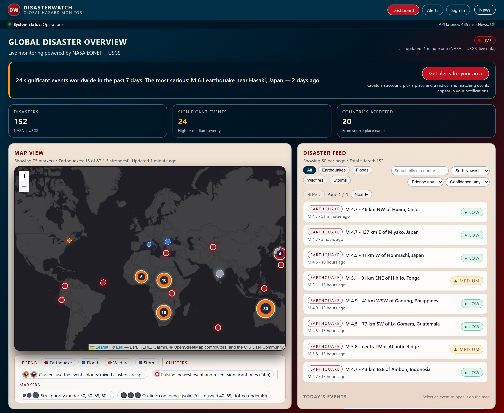
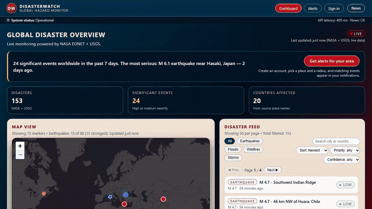
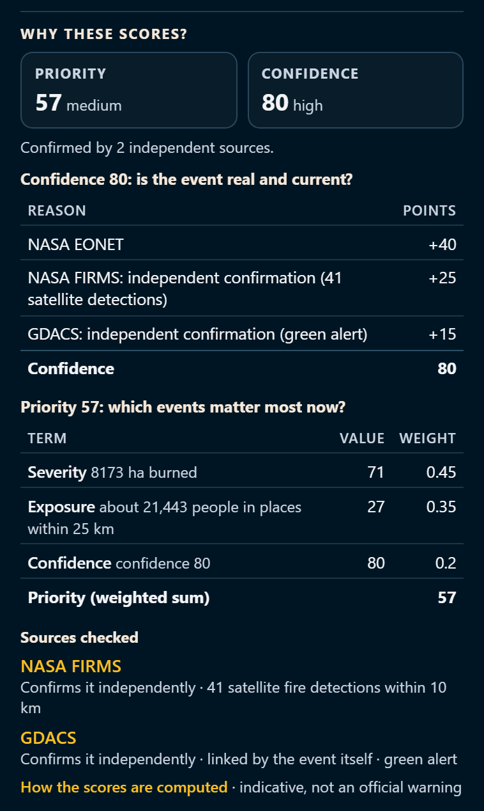
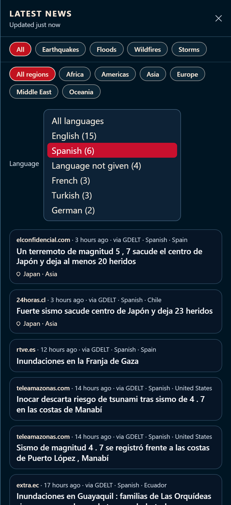
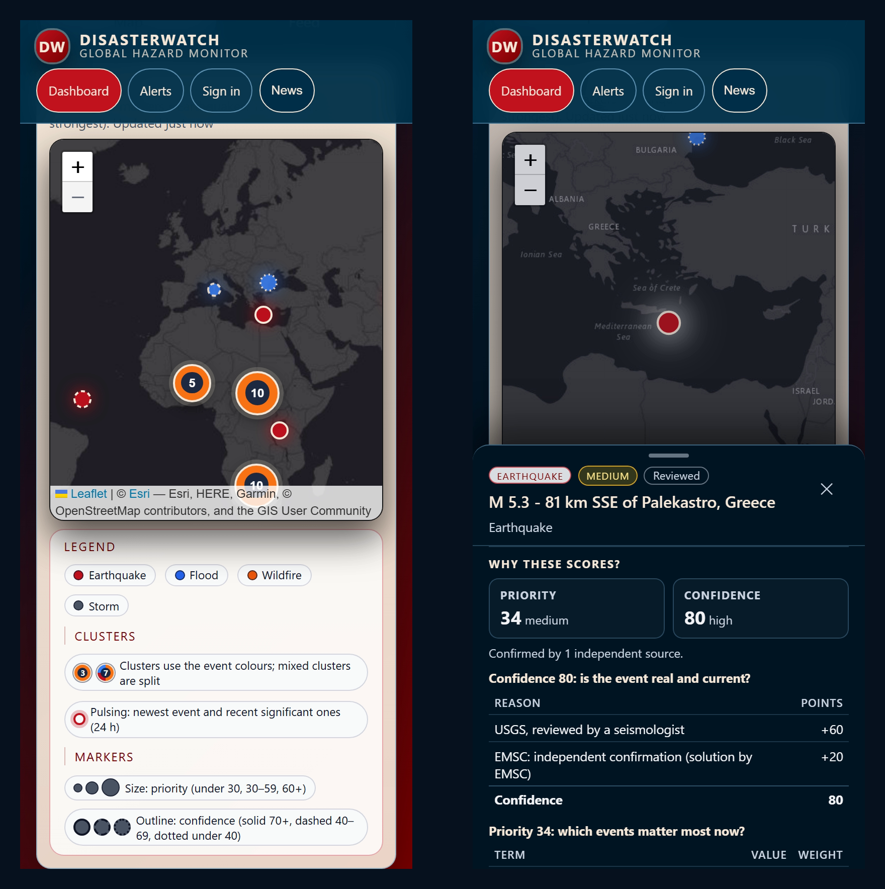
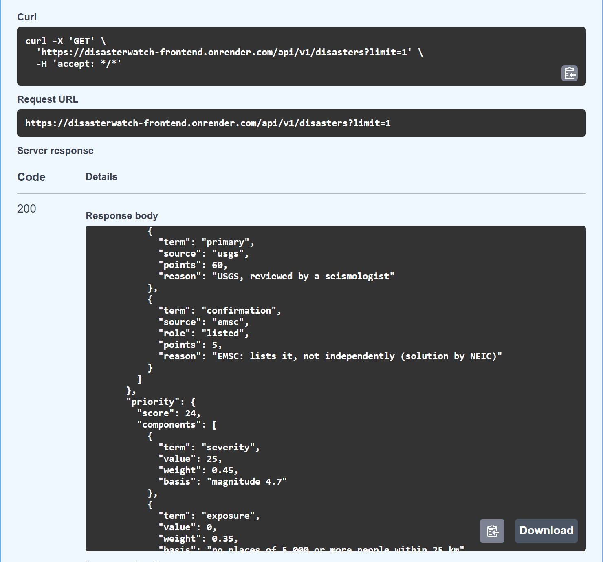
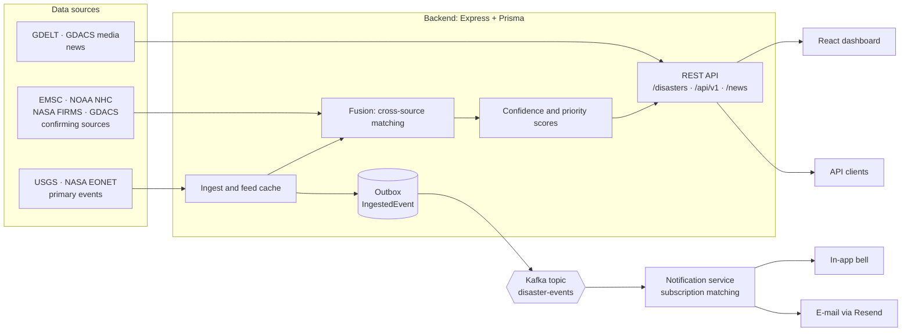

# DisasterWatch

**A live global disaster map that cross-checks every event against independent sources and shows exactly how each score was calculated.**

[](https://github.com/OrhanIzmirli/DisasterWatch/actions/workflows/ci.yml)
[](https://disasterwatch-frontend.onrender.com)
[](https://disasterwatch-frontend.onrender.com/api)
[](LICENSE)

**[Live demo](https://disasterwatch-frontend.onrender.com)** · **[API docs](https://disasterwatch-frontend.onrender.com/api)** · [Demo video (MP4)](docs/images/demo.mp4)



> Portfolio project on free hosting: the first request after a quiet spell can take up to a minute. It is not an official warning service. For warnings and evacuation orders, follow your local authorities.



## Highlights

- **Multi-source confirmation.** USGS and NASA EONET events are checked against EMSC, NOAA NHC, NASA FIRMS and GDACS. Matches are one-to-one and mutual best, so nearby events are not merged by accident.
- **Open scoring.** Every event gets a confidence and a priority score from 0 to 100. Each score comes with the terms behind it. Nothing is learned or hidden.
- **Public API with OAuth keys.** Read-only `/api/v1`, OpenAPI 3.1, cursor paging and ETags. No key needed for 60 requests a minute, or sign in with GitHub for a key with 600.
- **News in six languages.** GDELT articles in English, Turkish, Spanish, French, German and Portuguese, with language-aware relevance rules and country placement.
- **Event-driven alert pipeline.** Transactional outbox, Kafka and an idempotent consumer: at-least-once delivery, at most one notification per user and event.
- **Tested and accessible.** 1,136 automated tests in CI, visual regression at 1440 px and 390 px, and WCAG 2.1 AA checks with axe-core.

## See it

| "Why these scores?" | News with language picker | Phone (390 px) |
|---|---|---|
|  |  |  |

**Public API, a real "Try it out" response:**



## Architecture



The public map needs only the backend and the sources. Kafka, the notification service and Resend carry the alerts, each part degrades on its own, and `/health` reports its state. More in [Architecture](docs/architecture.md).

## Engineering decisions

**Licences decide what the API may say: GDACS.** GDACS's [terms](https://www.gdacs.org/About/termofuse.aspx) contain disclaimers but grant no redistribution licence. So the API passes on only its alert level and a link to its report, never its impact figures, and news stays out of the public API altogether. [Data sources](docs/sources.md)

**A rate limit that passed its tests and failed in production.** Behind Cloudflare and Render's proxy hops, `req.ip` was an internal address that changed between requests. A live test of 70 anonymous requests showed one client spread over three counters, and unrelated clients could share one. Limiters now use `True-Client-IP` or `CF-Connecting-IP`, and a live check confirmed that a client cannot forge either.

**Two sources are not always two witnesses: EMSC.** EMSC often relays the USGS solution for an earthquake. Counting that as confirmation would inflate confidence, so the entry's computing agency decides: an independent agency adds +20, a USGS relay is only "listed" and adds +5. In the evaluation run, 209 of 715 matched EMSC entries turned out to be relays. [Scoring](docs/scoring.md)

**A transparent formula instead of a black box.** A score people act on should be checkable, so both formulas are plain arithmetic, and the API returns every term with a `scoreVersion`:

```text
confidence = primary source + independent confirmations (max 40) − staleness (max 20)
priority   = 0.45 × severity + 0.35 × exposure + 0.20 × confidence
```

Properties are tested as well: a confirmation never lowers confidence, and time never raises it.

## Tech stack

| Area | Tools |
|---|---|
| Frontend | React 19, TypeScript, Vite 7, Leaflet, Swagger UI |
| Backend | Node.js 24, Express 5, Prisma 6, Zod, KafkaJS |
| Notification service | Node.js 24, KafkaJS, `pg`, Zod |
| Data and messaging | PostgreSQL 16, Apache Kafka |
| Infrastructure | Docker Compose, Nginx, GitHub Actions |
| Live deployment | Render, Neon, Aiven, Resend, Cloudflare |

## Run it locally

Needs Docker with Compose v2. One command, then open http://localhost:8080:

```bash
git clone https://github.com/OrhanIzmirli/DisasterWatch.git && cd DisasterWatch && cp backend/.env.example backend/.env && docker compose up --build
```

Step-by-step notes, ports and reset commands: [Quick start](docs/quick-start.md).

## Tests

| Suite | Tests | Tools |
|---|---:|---|
| Backend, including OpenAPI contract tests | 845 | Vitest, supertest, Ajv, PostgreSQL |
| Frontend | 161 | Vitest, Testing Library |
| Notification service | 73 | Vitest |
| Visual and accessibility, at 1440 px and 390 px | 57 | Playwright, axe-core |

All four run on every push and pull request. Commands and setup: [Tests and CI](docs/operations.md#tests-and-ci-in-detail).

## Limits

Alerts can be hours late, because free services sleep. Events come only from what USGS (M 4.5+) and NASA EONET report. Volcanoes, landslides and official warnings are not covered. Full list: [Limits](docs/operations.md#limits).

## Documentation

| Topic | Document |
|---|---|
| Services, pipeline, event contract | [Architecture](docs/architecture.md) |
| Endpoints, public API design | [HTTP API](docs/api.md) |
| Matching and score formulas | [Scoring](docs/scoring.md) |
| How events are rated | [Severity](docs/severity.md) |
| Sources and licences | [Data sources](docs/sources.md) |
| Providers, relevance rules, regions | [News](docs/news.md) |
| Deployment, environment, tests | [Operations](docs/operations.md) |
| More screenshots | [Screenshots](docs/screenshots.md) |
| History and contributing | [Changelog](CHANGELOG.md) · [Contributing](CONTRIBUTING.md) |

## Licence and data

The code is under the [MIT licence](LICENSE). The data belongs to its sources and keeps their terms, listed in [Data sources](docs/sources.md); API responses carry the required attribution. Map tiles © Esri and contributors.

## Author

Orhan Izmirli, Computer Science student (Poland). Focus: full-stack development, event-driven architecture and cloud deployment.
