# Screenshots

Back to the [README](../README.md).

Captured on the first build (2026-03-09); the layout has been refined since, the behaviour is the same.

| | |
|---|---|
| **Dashboard** – KPIs, map, live feed 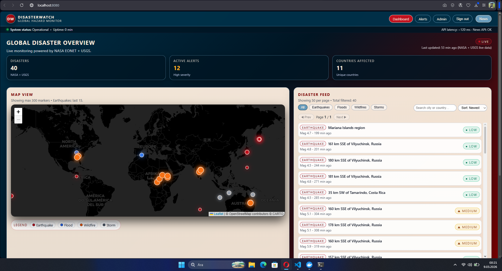 | **Backend health through the proxy** 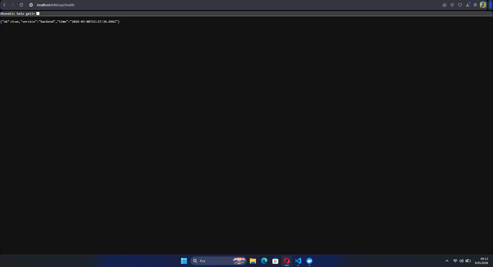 |
| **Normalized feed** (`/api/disasters`) 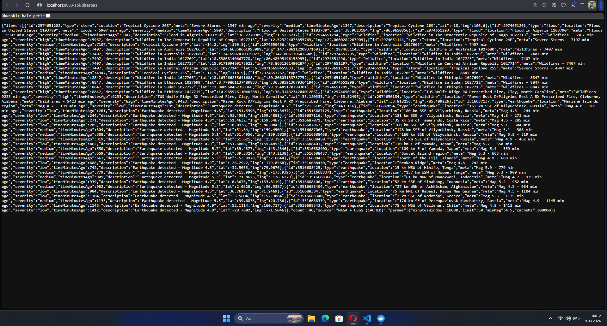 | **Feed, alternative capture** 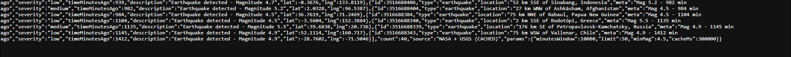 |
| **All services up** (`docker compose ps`) 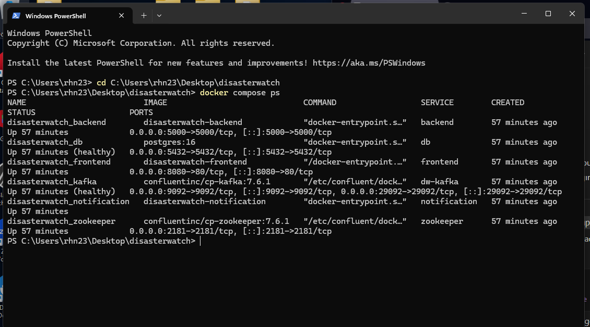 | **Consumer receives an event** 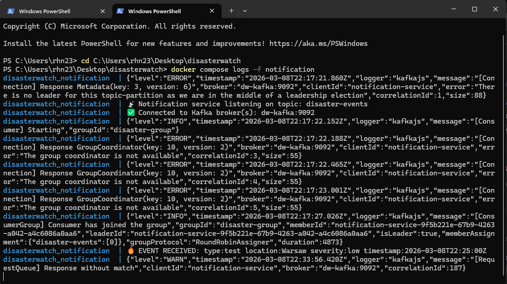 |
| **Topic exists** (`disaster-events`) 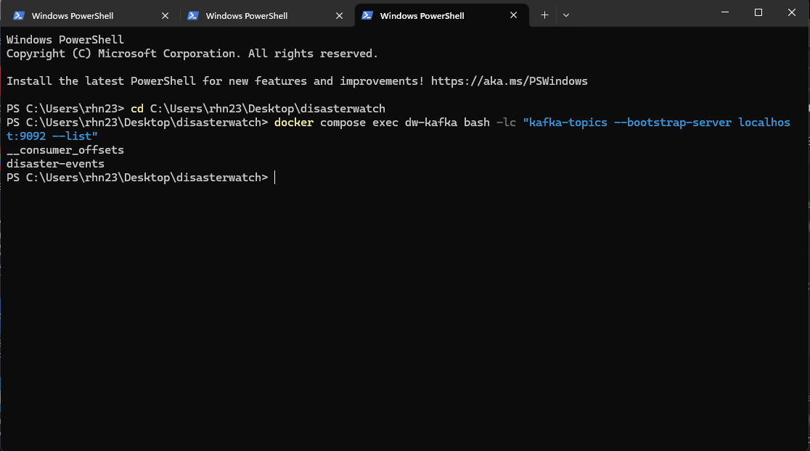 | **Filter: earthquakes** 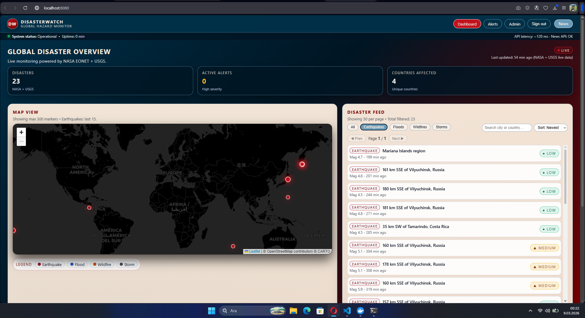 |
| **Filter: wildfires** 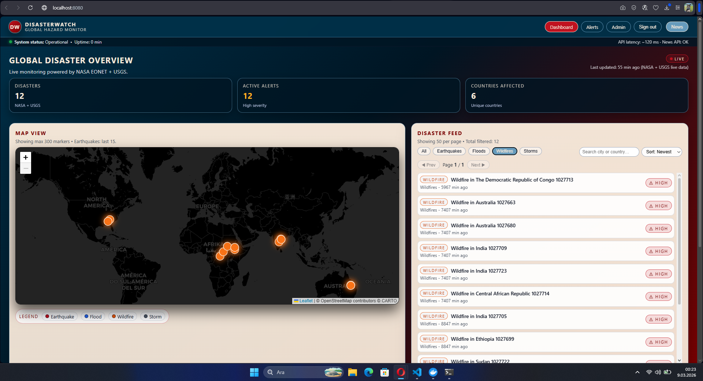 | **Search by country or city** 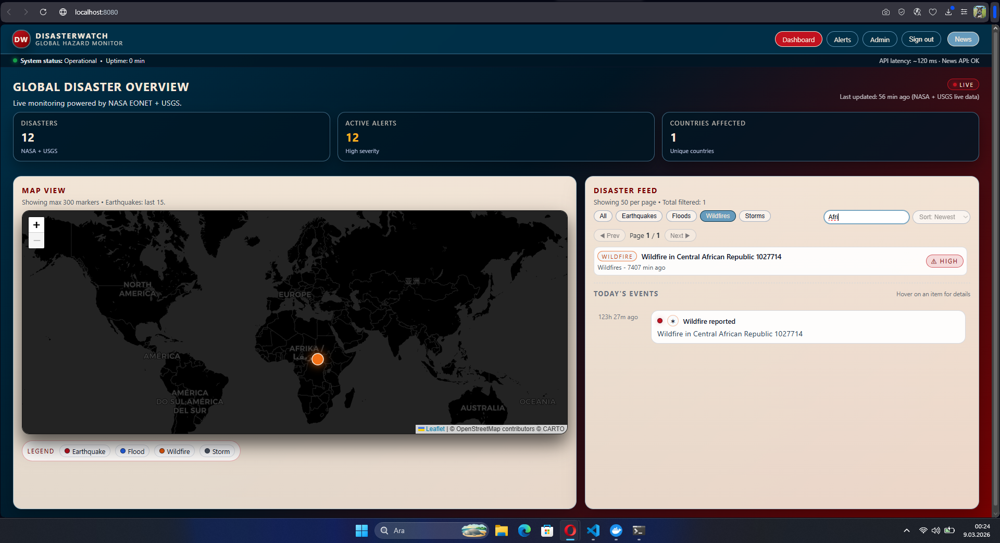 |
| **Sort: newest** 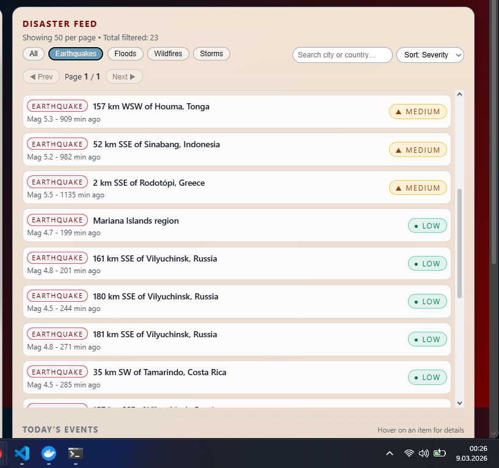 | **Sort: severity** 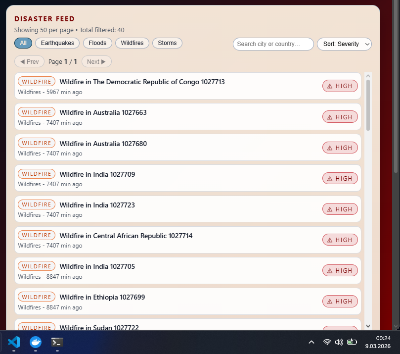 |
| **Severity badges** 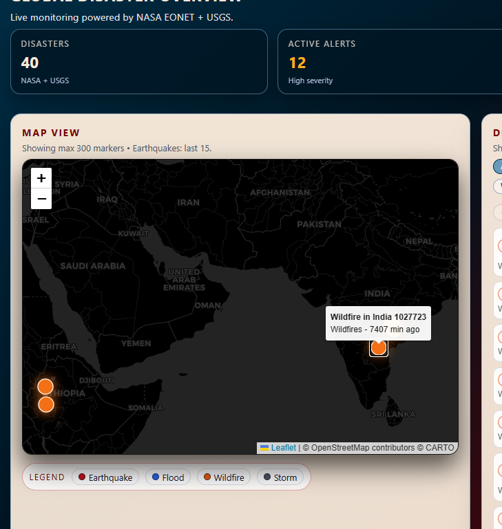 | **Marker popup** 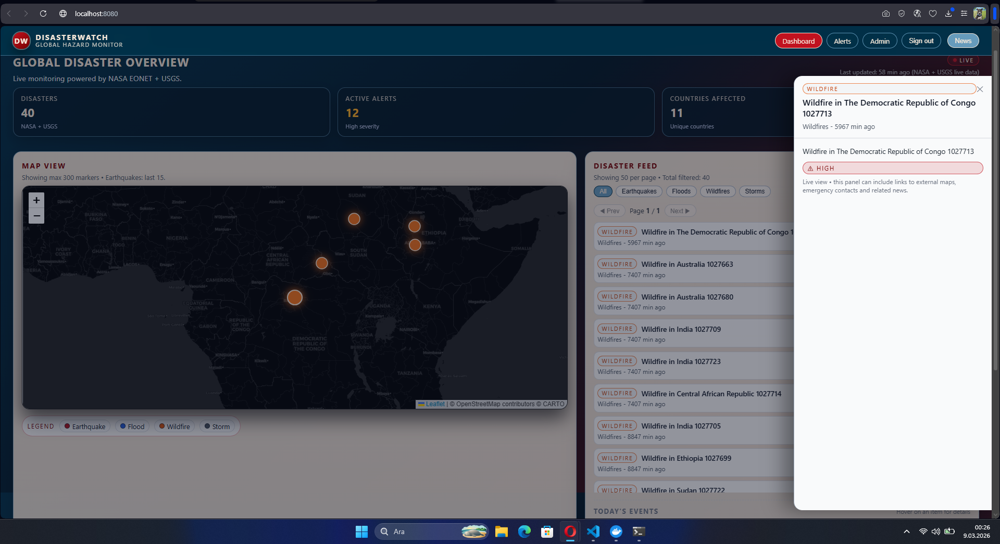 |
